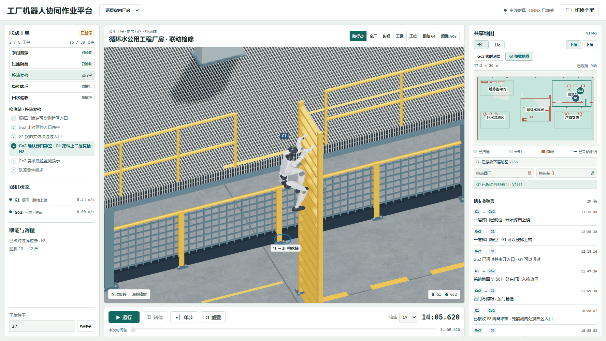

# 工厂机器人协同作业平台

**Factory Robot Collaboration Platform**

[下载 Windows 版](https://github.com/ZHT1235456/factory-robot-collaboration-platform/releases/latest) · [软件开发日志 PDF](docs/工厂机器人协同作业平台软件开发日志.pdf) · [LaTeX 源码](docs/工厂机器人协同作业平台软件开发日志.tex)

基于同级「机器狗」项目的 Unitree G1 和 Go2。MuJoCo 求解双机与楼梯、检修升降台、工具及设备的接触。Three.js 渲染室内厂房和室外冷却水站，Vite 提供开发入口，Tauri 2 生成 Windows x64 单文件程序。

Windows x64 版可双击启动，默认全屏，按 **F11** 切换窗口。程序使用 Microsoft Edge WebView2。当前源码的单文件构建名为 `工厂机器人协同作业平台.exe`，体积 **38.69 MiB**。

「随行动」会在 G1 或 Go2 开始移动或发言时切换镜头。同一帧内发言优先，两台持续同时移动时保持当前跟拍。Go2 停驻测绘时镜头继续跟随，回看会恢复当时的自动镜头。手动选取其他视角后，可点「随建图」或「随行动」恢复自动切换。点击左侧工单可查看对应工区的模型和地图。长距离转场可用 16× 或 24×，暂停后拖动时间轴可回看动作、栅格和气泡。

## 运行截图

[室外冷却水站巡检](assets/yard-inspection.png) · [泵房协同开盖](assets/factory-pump-cooperation.png) · [Go2 建图](assets/factory-map-follow-go2.png) · [G1 接收地图](assets/factory-map-handoff.png)

## 场景和工单

顶部场景选择器可在「两层室内厂房」与「室外冷却水站」之间切换。室内俯视时可用共享地图的楼层按钮查看一层或二层。室外场景布置两座冷却塔，Go2 先测绘并找出低位回水异常，G1 按收到的地图到对应温度表取证，双方复测后联签。

室内占地 **47.2 × 26 m，共 1,227.2 m²**，是原循环水泵房 122.72 m² 的十倍。泵房的二层连通东侧检修走道，换热区设有从一层通往二层的固定检修梯和返回用的下行升降台。室内五张连续工单共有 **30 个步骤**。室外场地为 **24 × 16 m**，冷却塔巡检共有 **5 个步骤**。

| 工单 | 双机分工与验收 |
| --- | --- |
| 泵组测振 | Go2 进入 G1 步行无法进入的低位管架取证。G1 确认柜号和梯口后下楼，协同开盖，再从箩筐取记录器布设到异常泵。 |
| 过滤隔离 | Go2 读取两路低位压差指示，G1 核对对应控制位号。收到清场回执后，G1 操作模拟隔离按钮，由 Go2 核对状态灯。 |
| 换热复检 | Go2 勘测两处入口并确认一层梯口净空。G1 通过检修梯跨档爬升 2.8 m，在梯顶侧移并双脚踏上二层格栅，走到 H2 巡检台核对位号。G1 乘下行升降台返回一层，Go2 复核低位回流指示，双方联签备件单。 |
| 备件转运 | Go2 核对两处货位并驻车。G1 夹取指定备件，按接触载荷称重。备件落在筐底并稳定后才闭合运输卡扣。 |
| 回水验收 | Go2 运抵交接位后，G1 卸件并把备件固定在验收托架。收到隔离和位置的复核结果后，G1 操作本地确认按钮，由 Go2 读回状态灯并签收。 |

不同种子改变泵位、梯口、检修车状态、换热入口和备件。默认种子 17 对应 P2 / F2、B 梯、换热东门和 S2 滤网组件。种子 14 会使用 A 梯、换热西门和 S1 密封件包。

启动联动作业后，Go2 先沿 31 个地面观测点独立建图。二维栅格边长 **0.25 m**，用 MuJoCo 位姿将测距回波投影到厂房坐标系。每轮扫描以对数几率累计沿途空闲与命中占用的证据。未获得证据的格子保持未知，夹层由 G1 到岗后单独观测。算法参考 [Alberto Elfes 的占用栅格论文](https://www.cs.cmu.edu/~motionplanning/papers/sbp_papers/integrated4/elfes_occup_grids.pdf)。

Go2 每轮按全周分布采样 112 条最大量程 5 m 的平面射线。遇机身、腿或箩筐遮挡时剔除该方向的射线，通过移动和转向补采。宇树官网的 Go2 L2 雷达标称视场为水平 360°、垂直 96°。 [Go2 官方规格](https://www.unitree.com/go2/)

覆盖检查通过后，Go2 发送带版本号、坐标系和栅格数据的下层地图。G1 解码并确认接收，再开始联动工单。右侧可在「Go2 实时测绘」和「G1 接收地图」间切换。过滤区转场和换热区入口通行使用收到的版本。规划只走已观测的空闲格，直线受阻时用 A* 搜索，并检查身体净空。[A* 原论文](https://ai.stanford.edu/~nilsson/OnlinePubs-Nils/PublishedPapers/astar.pdf)

压差和回水控制状态按场景逻辑模拟，测振是仿真读数，备件秤重使用 MuJoCo 的实际载荷。应用参考可见 [Eaton 双联过滤器](https://www.eaton.com/us/en-us/catalog/filters-strainers/model-52-10-18-inch-basket-strainer.html) 和 [Alfa Laval 板式换热器检修资料](https://www.alfalaval.com/service-and-support/product-services/plate-heat-exchanger-services/troubleshooting-for-plate-heat-exchangers/)。

Go2 在测绘点发出青色扫线，在读表或检查净空时显示定向探测线，琥珀色光点标出仿真射线的回波。暂停及拖动时间轴时可检查当时的探测画面。

## 动作策略和验收

沿用实验室服务器训练的 SuperMimic 接触和足端 ONNX 策略。G1 步态结合对侧摆臂、脚跟滚动、脚尖蹬离和单脚承重。Go2 使用对角腿交替支撑。仿真由底座引导、逆运动学和限矩伺服执行。机器人模型许可见 [Go2](model/LICENSE) 和 [G1](model/G1-LICENSE)。

H2 检修梯实时加载跨档 ONNX。登梯、跨档、梯顶换握与侧向转移与厂房时钟同步。爬梯使用同一厂房坐标下的局部 MuJoCo 接触模型，抓握采用简化接触约束。双脚获得二层格栅支撑后恢复厂房步行控制，G1 到 H2 巡检台并通过射线检查确认位号可见。

- [检修梯上楼与室内外场景验收](results/ladder-floor-access-validation.json)
- [扩建厂房工况验收](results/factory-validation.json)
- [v1.0.1 Windows 包验收](results/windows-verification.json)与[运行界面](assets/factory-console-implementation.png)
- [G1 接触策略](results/g1-contact-policy.onnx)与[训练记录](results/training.json)
- [双机足端跟踪策略](results/foot-tracking-policy.onnx)与[训练记录](results/gait-training.json)
- [G1 跨两档策略](results/g1-ladder-skip-policy.onnx)、[训练记录](results/ladder-skip-training.json)与[独立动作验证](results/ladder-skip-validation.json)
- [原泵房验收](results/validation.json)与[G1 平地步态对测](results/g1-walk-verification.json)

在项目的 MuJoCo 推理环境可复核默认验收矩阵。

~~~powershell
python training/verify_factory.py --seeds 0 11 14 17 --workers 4 --output results/ladder-floor-access-validation.json
~~~

## 设计和构建

设计阶段调用 ImageGen 技能生成厂房多视角参考、泵房细节图和界面设计稿。三维场景按参考图细化了格栅、检修车、开放式货架和设备管接头。圆角主通道、工区虚线、门口白线和交接位斜纹按厂房坐标绘制。

[全厂参考图](assets/imagegen/maps/factory-utility-hall.png) · [泵房参考图](assets/imagegen/maps/pump-cooperation-map.png) · [界面设计稿](assets/imagegen/factory-console.png) · [全厂俯视](assets/factory-floor-plan.png) · [换热工区近景](assets/factory-floor-detail.png) · [地面材质](assets/imagegen/factory-floor.webp) · [生成记录和提示词](assets/imagegen/prompts.md)

在 Windows 上构建需要 Node.js、Python、Rust MSVC 和 Visual C++ 工具链。可将 `COLLAB_PYTHON` 指向已有的推理环境。

~~~powershell
python -m venv .inference-env
& ./.inference-env/Scripts/python.exe -m pip install -r training/inference-requirements.txt
npm.cmd ci
npm.cmd run desktop:build
~~~

本地调试可运行 `npm.cmd run dev`。构建产物位于 `src-tauri/target/release/工厂机器人协同作业平台.exe`。EXE 内置模型、界面、ONNX 策略和本地推理引擎，首次运行时在应用缓存目录展开引擎。随包许可见 [第三方许可说明](docs/THIRD-PARTY-NOTICES.txt)。
